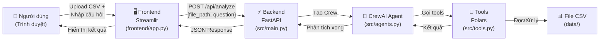
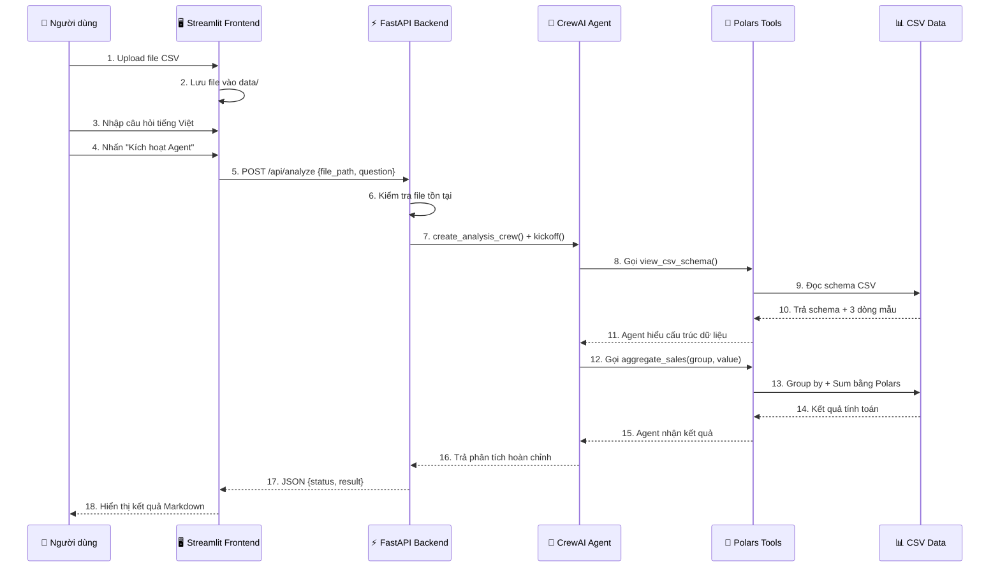

# SmartData & AI Expert Copilot - Trợ Lý Chuyên Gia Toàn Năng & Phân Tích Dữ Liệu

## 🎯 Mục tiêu dự án
Dự án cung cấp một nền tảng **Trợ lý AI Chuyên gia Đa năng (AI Expert Copilot)** và **Hệ thống Multi-Agent Phân tích Dữ liệu Lớn (CrewAI + Polars)**:
1. **Trò chuyện Mở Đa Chuyên Môn (Open Expert Chat)**: Thảo luận sâu sắc về lập trình (mọi ngôn ngữ, kiến trúc hệ thống, clean code, debug), khoa học dữ liệu, kinh doanh, học tập... mà **không bị gò bó bởi bất kỳ thư mục hay tệp tin nào**.
2. **Linh Hoạt Đọc Tệp Bất Kỳ Đâu**: Bạn có thể trò chuyện tự do không cần file, hoặc kéo thả tệp, hoặc nhập trực tiếp đường dẫn file bất kỳ trên ổ cứng (C, D, E...) để AI phân tích.
3. **Phân Tích Dữ Liệu & Dựng Mô Hình 3D Tự Động**: Tự động tổng hợp số liệu tốc độ cao bằng Polars và vẽ biểu đồ 2D/3D nổi khối trực quan.

## 🛠️ Công nghệ sử dụng

| Thành phần | Công nghệ | Mã nguồn mở (GitHub) |
|------------|-----------|----------------------|
| **Backend** | Python 3.10+, FastAPI, Uvicorn | [fastapi/fastapi](https://github.com/fastapi/fastapi) ・ [encode/uvicorn](https://github.com/encode/uvicorn) |
| **AI Agent Core** | CrewAI, CrewAI Tools | [crewAIInc/crewAI](https://github.com/crewAIInc/crewAI) ・ [crewAIInc/crewAI-tools](https://github.com/crewAIInc/crewAI-tools) |
| **Data Engine** | Polars (Tối ưu hiệu năng cao) | [pola-rs/polars](https://github.com/pola-rs/polars) |
| **Frontend** | Streamlit | [streamlit/streamlit](https://github.com/streamlit/streamlit) |
| **Validation** | Pydantic | [pydantic/pydantic](https://github.com/pydantic/pydantic) |
| **LLM SDK** | OpenAI Python | [openai/openai-python](https://github.com/openai/openai-python) |

---

## 🏗️ Kiến Trúc Tổng Quan



## 📂 Cấu Trúc Dự Án

```
SmartData-Agent/
├── src/                        # Backend core
│   ├── main.py                 # FastAPI server - điểm khởi chạy backend
│   ├── agents.py               # Định nghĩa CrewAI Agent & Task
│   └── tools.py                # Công cụ xử lý dữ liệu bằng Polars
├── frontend/
│   └── app.py                  # Giao diện người dùng Streamlit
├── data/
│   └── sample_sales.csv        # Dữ liệu mẫu (10 đơn hàng)
├── requirements.txt            # Các thư viện cần thiết
├── .gitignore
└── README.md
```

---

## 🔄 Phân Tích Chi Tiết Từng Bước Hoạt Động

### Bước 1: Người dùng tải file CSV lên giao diện

**File:** `frontend/app.py`

```python
uploaded_file = st.file_uploader("Bước 1: Tải lên file dữ liệu của bạn (CSV)", type=["csv"])

if uploaded_file is not None:
    file_path = os.path.join("data", uploaded_file.name)
    with open(file_path, "wb") as f:
        f.write(uploaded_file.getbuffer())
```

- Streamlit hiển thị widget upload cho phép kéo/thả file CSV.
- File được lưu tạm vào thư mục `data/` với tên gốc.
- Hàm `os.makedirs("data", exist_ok=True)` đảm bảo thư mục `data/` luôn tồn tại trước khi lưu.

---

### Bước 2: Người dùng nhập câu hỏi phân tích bằng tiếng Việt

**File:** `frontend/app.py`

```python
user_query = st.text_input("Bước 2: Nhập yêu cầu phân tích (Tiếng Việt):",
                           placeholder="Ví dụ: Tính tổng doanh thu theo từng mặt hàng?")
```

- Hỗ trợ nhập câu hỏi bằng tiếng Việt tự nhiên.
- Ví dụ: *"Tính tổng doanh thu theo từng mặt hàng?"*, *"Khu vực nào bán nhiều nhất?"*

---

### Bước 3: Frontend gửi request đến Backend FastAPI

**File:** `frontend/app.py`

```python
if st.button("Kích hoạt Agent phân tích"):
    with st.spinner("AI Agent đang phối hợp phân tích dữ liệu bằng Polars..."):
        backend_url = "http://127.0.0.1:8000/api/analyze"
        payload = {"file_path": file_path, "question": user_query}
        response = requests.post(backend_url, json=payload)
```

- Khi nhấn nút, Frontend gửi `POST` request đến `http://127.0.0.1:8000/api/analyze`.
- Payload gồm 2 trường: `file_path` (đường dẫn file CSV) và `question` (câu hỏi người dùng).
- Hiển thị spinner "đang xử lý" trong lúc chờ kết quả.

---

### Bước 4: Backend nhận request và kiểm tra file

**File:** `src/main.py`

```python
class AnalysisRequest(BaseModel):
    file_path: str
    question: str

@app.post("/api/analyze")
async def analyze_data(payload: AnalysisRequest):
    if not os.path.exists(payload.file_path):
        raise HTTPException(status_code=404, detail="Không tìm thấy file dữ liệu.")
```

- FastAPI tự động validate payload thông qua Pydantic model `AnalysisRequest`.
- Kiểm tra file có tồn tại không → nếu không, trả về lỗi HTTP 404.
- Server chạy trên `127.0.0.1:8000` thông qua Uvicorn.

---

### Bước 5: Backend khởi tạo CrewAI Agent và giao nhiệm vụ

**File:** `src/main.py` → `src/agents.py`

```python
# main.py - Kích hoạt CrewAI
crew = create_analysis_crew(payload.file_path, payload.question)
result = crew.kickoff()
```

```python
# agents.py - Tạo Agent
data_analyst = Agent(
    role="Chuyên viên Phân tích Dữ liệu Polars",
    goal="Đọc cấu trúc file dữ liệu và đưa ra các câu lệnh tính toán chính xác.",
    backstory="Bạn là một chuyên gia về Polars, hiểu rõ cách tối ưu hóa truy vấn dữ liệu lớn.",
    verbose=True,
    tools=[view_csv_schema, aggregate_sales]
)
```

- Hàm `create_analysis_crew()` tạo một **Crew** gồm 1 Agent chuyên phân tích dữ liệu.
- Agent được trang bị 2 tool: `view_csv_schema` và `aggregate_sales`.
- **Task** mô tả yêu cầu: phân tích file + trả lời câu hỏi của người dùng.
- `Process.sequential` nghĩa là Agent thực hiện tuần tự từng task.
- `crew.kickoff()` khởi động quá trình Agent suy luận và gọi tools.

---

### Bước 6: Agent sử dụng Tools để xử lý dữ liệu bằng Polars

**File:** `src/tools.py`

#### Tool 1: Đọc cấu trúc file CSV
```python
@tool("Đọc cấu trúc file CSV")
def view_csv_schema(file_path: str) -> str:
    df = pl.read_csv(file_path, n_rows=5)
    return f"Cấu trúc các cột: {str(df.schema)}\nVí dụ 3 dòng đầu:\n{str(df.head(3))}"
```
- Đọc 5 dòng đầu để lấy schema (tên cột + kiểu dữ liệu).
- Trả về 3 dòng mẫu để Agent hiểu nội dung dữ liệu.

#### Tool 2: Nhóm và tính tổng doanh thu
```python
@tool("Lọc và tính tổng doanh thu theo cột")
def aggregate_sales(file_path: str, group_column: str, value_column: str) -> str:
    df = pl.read_csv(file_path)
    result = df.group_by(group_column).agg(
        pl.col(value_column).sum()
    ).sort(value_column, descending=True)
    return str(result.head(10))
```
- Nhận tên cột nhóm (`group_column`) và cột giá trị (`value_column`).
- Dùng Polars `group_by` + `agg` để tính tổng.
- Sắp xếp giảm dần và trả về top 10 kết quả.

**Luồng suy luận của Agent:**
1. Agent gọi `view_csv_schema` → biết cấu trúc file có các cột: `order_id`, `date`, `product`, `category`, `quantity`, `price`, `total_revenue`, `region`.
2. Dựa trên câu hỏi người dùng, Agent tự quyết định gọi `aggregate_sales` với `group_column` và `value_column` phù hợp.
3. Ví dụ câu hỏi *"Tính tổng doanh thu theo khu vực"* → Agent gọi `aggregate_sales(file_path, "region", "total_revenue")`.

---

### Bước 7: Backend trả kết quả về Frontend

**File:** `src/main.py`

```python
return {"status": "success", "result": str(result)}
```

- Kết quả phân tích của Agent (dạng text) được đóng gói thành JSON response.
- Nếu có lỗi xảy ra, trả về HTTP 500 kèm chi tiết lỗi.

---

### Bước 8: Frontend hiển thị kết quả cho người dùng

**File:** `frontend/app.py`

```python
if response.status_code == 200:
    res_data = response.json()
    st.subheader("📊 Kết quả phân tích từ AI:")
    st.markdown(res_data["result"])
```

- Parse JSON response từ backend.
- Hiển thị kết quả dưới dạng Markdown trên giao diện Streamlit.
- Nếu lỗi kết nối → hiển thị thông báo lỗi tương ứng.

---

## 🔁 Tóm Tắt Luồng Hoạt Động



---

## 📊 Dữ Liệu Mẫu

File `data/sample_sales.csv` chứa 10 đơn hàng với cấu trúc:

| Cột | Kiểu | Mô tả |
|-----|------|-------|
| `order_id` | Integer | Mã đơn hàng |
| `date` | String | Ngày đặt hàng (YYYY-MM-DD) |
| `product` | String | Tên sản phẩm |
| `category` | String | Danh mục (Electronics, Accessories, Furniture) |
| `quantity` | Integer | Số lượng |
| `price` | Integer | Đơn giá (VNĐ) |
| `total_revenue` | Integer | Tổng doanh thu (VNĐ) |
| `region` | String | Khu vực (North, South, Central) |

---

## 🚀 Hướng Dẫn Cài Đặt và Khởi Chạy

### Bước 1: Khởi tạo môi trường ảo và cài đặt thư viện
```bash
python -m venv venv

# Windows
venv\Scripts\activate

# macOS / Linux
source venv/bin/activate

pip install -r requirements.txt
```

### Bước 2: Cấu hình API Key (CrewAI cần LLM để hoạt động)
Tạo biến môi trường cho API Key của bạn:
```bash
# Windows (CMD)
set OPENAI_API_KEY=sk-your-key-here

# Windows (PowerShell)
$env:OPENAI_API_KEY="sk-your-key-here"

# macOS / Linux
export OPENAI_API_KEY="sk-your-key-here"
```

### Bước 3: Khởi chạy hệ thống

**Terminal 1** — Chạy Backend FastAPI:
```bash
python -m src.main
```
Backend sẽ chạy tại: `http://127.0.0.1:8000`

**Terminal 2** — Chạy Frontend Streamlit:
```bash
streamlit run frontend/app.py
```
Frontend sẽ mở tại: `http://localhost:8501`

### Bước 4: Sử dụng
1. Mở trình duyệt tại `http://localhost:8501`
2. Tải lên file CSV (hoặc dùng file mẫu `data/sample_sales.csv`)
3. Nhập câu hỏi phân tích bằng tiếng Việt
4. Nhấn **"Kích hoạt Agent phân tích"** và chờ kết quả

---

## 📋 Kiểm Thử (Testing)
```bash
pytest
```

---

## 🔗 Tham Khảo Mã Nguồn Mở

Dự án được xây dựng dựa trên các thư viện mã nguồn mở sau:

| Thư viện | GitHub | Stars | License | Mô tả |
|----------|--------|-------|---------|-------|
| **CrewAI** | [crewAIInc/crewAI](https://github.com/crewAIInc/crewAI) | 28k+ | MIT | Framework xây dựng hệ thống Multi-Agent AI |
| **CrewAI Tools** | [crewAIInc/crewAI-tools](https://github.com/crewAIInc/crewAI-tools) | 1k+ | MIT | Bộ công cụ mở rộng cho CrewAI Agent |
| **Polars** | [pola-rs/polars](https://github.com/pola-rs/polars) | 32k+ | MIT | DataFrame engine viết bằng Rust, nhanh hơn Pandas |
| **FastAPI** | [fastapi/fastapi](https://github.com/fastapi/fastapi) | 82k+ | MIT | Web framework hiệu năng cao cho Python API |
| **Uvicorn** | [encode/uvicorn](https://github.com/encode/uvicorn) | 9k+ | BSD-3 | ASGI server chạy FastAPI |
| **Streamlit** | [streamlit/streamlit](https://github.com/streamlit/streamlit) | 40k+ | Apache 2.0 | Framework tạo giao diện web cho ứng dụng dữ liệu |
| **Pydantic** | [pydantic/pydantic](https://github.com/pydantic/pydantic) | 22k+ | MIT | Thư viện validation dữ liệu bằng Python type hints |
| **OpenAI Python** | [openai/openai-python](https://github.com/openai/openai-python) | 25k+ | Apache 2.0 | SDK chính thức để gọi OpenAI API |

> **Tài liệu tham khảo thêm:**
> - [CrewAI Documentation](https://docs.crewai.com/)
> - [Polars User Guide](https://docs.pola.rs/)
> - [FastAPI Documentation](https://fastapi.tiangolo.com/)
> - [Streamlit Documentation](https://docs.streamlit.io/)

---

## 📝 License
MIT
